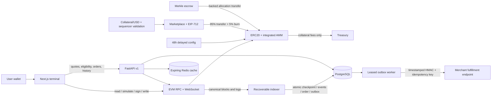

# Architecture and state authority

| State | Authority | Projection / consumer |
|---|---|---|
| Token balances, outstanding supply, curve coefficients | MudTokenAMM on canonical chain | Wallet reads, API block snapshots, indexed events |
| Reserve balance | Reviewed collateral token balanceOf(AMM) | AMM health check and dashboard |
| Accrued fees | AMM; treasury only collects those fees | Treasury receipt accounting |
| Product price, inventory, merchant status, buyer limits | MudMarketplace | API catalog and client quote reads |
| USD reference and freshness | Configured immutable price and L2 uptime feeds through MudPriceOracle | Quote rejection, dashboard metadata |
| Fee and max trade policy | MudProtocolConfig with delayed execution | AMM view functions; ConfigUpdated logs |
| Merkle entitlement commitment / claimed bitmap | MudAirdrop | Versioned private-process eligibility dataset is the proof source |
| Eligibility evidence | Off-chain reviewed dataset process | Only addresses, indices, allocations are committed |
| Unsigned order intent | Database | Buyer independently validates and signs EIP-712 |
| Payment | Successful canonical OrderSettled event | Durable order state; frontend receipt is supplementary evidence |
| Confirmation / block-depth finality | Configured canonical RPC depth policy | OBSERVED / CONFIRMED / FINALIZED, not an L1-finality assertion |
| Digital delivery | Merchant endpoint's durable business state | HMAC acknowledgment and outbox delivery records |
| Local demo delivery | Order-unique Entitlement plus FulfillmentReceipt per notification | Explicitly local; no external goods implied |

The database is a rebuildable payment projection, plus non-rebuildable order-intent and delivery audit data. Preserve backups of the latter. Do not reconstruct order IDs from transaction hashes. Event identity is `(chain_id, tx_hash, log_index)`; multiple events in one transaction are distinct. Orphaned records are retained and can be updated if the same tx/log is re-mined. Block hashes and parent checks are committed atomically with checkpoints. Batch read failure rolls back the entire batch.

PostgreSQL advisory transaction locks serialize indexers per chain. Outbox workers use FOR UPDATE SKIP LOCKED, expiring leases and attempt-fenced acknowledgments. SQLite is an explicit single-process test/fallback adapter; it cannot establish PostgreSQL concurrency guarantees. HTTP backfill is authoritative; WebSocket new heads wake it sooner. Reconnects always catch up from the committed checkpoint. New-head timeouts preserve the pending subscription iterator rather than cancel it.

A reorg cancels unsent fulfillment, marks affected orders REORGED and sends a compensating payment.reorged notification if delivery was acknowledged or in flight. Exactly-once external side effects cannot be guaranteed by HTTP; merchant receivers must atomically deduplicate the stable idempotency key with their business operation. Uncertain requests can arrive twice or out of order. The local receiver serializes each order, keeps one business entitlement across re-inclusions and retains compensations so a late orphan confirmation cannot reactivate a revoked settlement. Deep reorgs beyond the configured search bound stop automatic progress and require operator reconciliation.

ABI v1 is exported from the same compiled artifacts to `abi/` and `frontend/lib/abi.ts`. Python uses the JSON exports; frontend and deployment scripts use the same constructors and method signatures. Runtime addresses live in per-chain deployment manifests, copied to the client public directory by the deployment script. Each backend process uses one chain and rejects mismatched RPC IDs. Run separate database schemas/services for independent environments.

Hardhat 2 + solc-js 0.8.24 is the single Solidity toolchain. It uses locally pinned compiler code and fast-check for deterministic fuzzing; no second Foundry configuration is implied. Contracts are immutable non-proxy deployments. Moving curve/collateral requires an explicit new deployment and migration reviewed independently.
